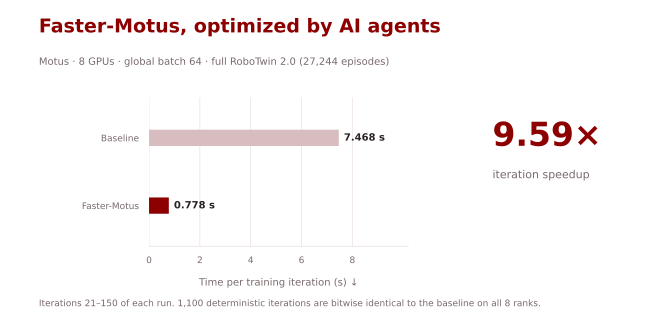
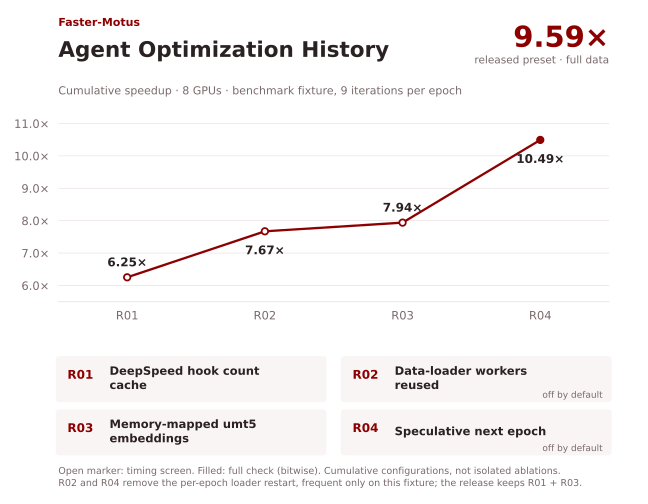
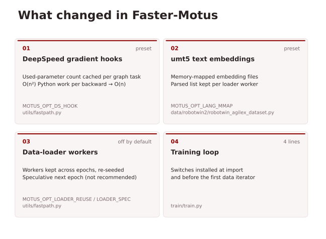

# Faster-Motus

[English](README.md) | [简体中文](README.zh-CN.md)

**Motus 每次训练迭代加速 9.59 倍，全部优化由 AI 智能体完成。**



| 实现 | 每次训练迭代耗时（s）↓ | 加速比 ↑ |
|---|---:|---:|
| 基线 | 7.468 | 1.00× |
| **Faster-Motus** | **0.778** | **9.59×** |

在 **8 张 GPU** 上使用完整的 RoboTwin 2.0 数据测得。在确定性模式下，Faster-Motus 的训练迭代与基线**逐位一致**。

## 快速开始

参照上游 Motus 准备[环境、权重和数据](docs/agent-environment.md)。在 `configs/robotwin.yaml` 中填好路径后，加载 Faster-Motus 开关并运行上游脚本（8 张 GPU，每卡 batch 8）：

```bash
source scripts/faster-motus.env.sh   # MOTUS_OPT_DS_HOOK=1 MOTUS_OPT_LANG_MMAP=1
bash scripts/train.sh
```
不设置这些开关时，运行的就是基线的代码路径。

## Agent 优化过程

<!-- 以下是在基准 fixture 上的测量结果：8 张 GPU，RoboTwin 2.0 的 496 条 episode 子集，每个 epoch 只有 9 次迭代。一个 AI 编程智能体（Claude Code）在冻结的评测器下工作，评测器包括固定的工作负载、计时规程，以及逐位检查和 100 次迭代的轨迹检查。它先做 profile（当时 GPU 只有 14% 的时间在忙），然后用约两小时进行了五轮优化，其中四轮保留了改动（R01–R04）。在 fixture 上，最终完整检查以逐位一致通过，加速 10.49 倍；独立复测为 10.39 倍。 -->
在 8 张 GPU 上，使用 Motus 的 RoboTwin 2.0 训练配置测得。



<!-- R02 和 R04 去掉的是 data loader 在每个 epoch 的重启。在这个小 fixture 上重启很频繁；在完整数据上一个 epoch 有 532 次迭代，重启只占约 1%。因此发布的预设只保留 R01 和 R03，在完整数据上加速 **9.59 倍**。 -->

## 主要改动

- **DeepSpeed 梯度 hook（`MOTUS_OPT_DS_HOOK`，预设开启）：** DeepSpeed 0.18 的 ZeRO-1/2 hook 在每个张量的 hook 里，都对全部 1,361 个可训练张量统计一遍参与反向传播的参数。这项 O(n²) 的 Python 开销占掉每次约 7.5 s 迭代中的 6.6 s；现在这个计数按 autograd graph task 缓存。
- **umt5 文本 embedding（`MOTUS_OPT_LANG_MMAP`，预设开启）：** 原来每个样本要读完整个约 52 MB 的 embedding 文件，只用其中约 100 条里的一条。现在改为内存映射（得到的张量完全相同），并在每个 loader worker 中缓存解析结果。
- **data loader worker（`MOTUS_OPT_LOADER_REUSE`、`MOTUS_OPT_LOADER_SPEC`，默认关闭）：** 跨 epoch 保留 worker，以及投机准备下一个 epoch。它们在完整数据上没有带来加速，也不推荐在完整数据上使用 LOADER_SPEC，原因见[完整数据结果](docs/full-data-results.md#why-the-preset-leaves-out-loader_spec)（英文）。



<!-- 所有改动都在主机端，kernel、精度和数学运算都没有改。详见[逐文件说明](docs/change-views/review-table.md)和[预设](scripts/faster-motus.env.sh)。 -->

## 正确性验证

**数值一致性。** 我们比较了 Faster-Motus 与基线在训练过程中每次迭代 loss 的数值一致性。两组运行都在完整数据上、确定性模式下进行，每个 rank 使用相同的种子：

| 对比 | 迭代数 | 结果 |
|---|---:|---|
| 基线 vs Faster-Motus 预设 | 1,100 | 8 个 rank 逐位一致 |
| 基线 vs 四个开关全开 | 1,100 | 8 个 rank 逐位一致 |

<!-- 对比覆盖每次迭代的 loss、学习率和 batch，第 500 和 1,000 次迭代的验证指标，以及最终的参数、fp32 master 权重和 Adam 状态，并跨过了两个 epoch 边界。

实验设置、各组开关的计时和这次验证的局限见[完整数据结果](docs/full-data-results.md)（英文）。要在其他硬件上复现，参见 [`skills/validate-faster-motus`](skills/validate-faster-motus/SKILL.md)。Faster-Motus 还没有跑过完整训练，也没有做 RoboTwin 评测。 -->

## 上游 Motus 文档

基于 [thu-ml/Motus](https://github.com/thu-ml/Motus) 的 `88f6fe3`，作者为 Hongzhe Bi、Hengkai Tan、Shenghao Xie 等。[论文](https://arxiv.org/abs/2512.13030) · [项目主页](https://motus-robotics.github.io/motus) · [Apache-2.0 许可证](LICENSE)。下面保留了原始 README 和上游的作者信息。

<details>
<summary>原始 Motus README：概述、安装、模型权重、推理与训练</summary>


<!-- markdownlint-disable first-line-h1 -->
<!-- markdownlint-disable html -->
<!-- markdownlint-disable no-duplicate-header -->

<div align="center">
  <h1>Motus: A Unified Latent Action World Model</h1>
</div>

<div align="center" style="line-height: 1;">
  <a href="https://motus-robotics.github.io/motus"></a>
  <a href="https://huggingface.co/motus-robotics"></a>
  <a href="https://arxiv.org/abs/2512.13030"></a>
  <br>
  <a href="https://motus-robotics.github.io/assets/motus/png/feishu.jpg"></a>
  <a href="https://motus-robotics.github.io/assets/motus/png/wechat.jpg"></a>
  <a href="LICENSE"></a>
</div>

## Table of Contents
- [Table of Contents](#table-of-contents)
- [Overview](#overview)
- [Updates](#updates)
- [Requirements](#requirements)
- [Installation](#installation)
- [Model Checkpoints](#model-checkpoints)
- [Data Format](#data-format)
- [Running Inference](#running-inference)
- [Training](#training)
- [Troubleshooting](#troubleshooting)
- [Citation](#citation)

## Overview

**Motus** is a **unified latent action world model** that leverages existing pretrained models and rich, sharable motion information. Motus introduces a **Mixture-of-Transformers (MoT)** architecture to integrate three experts (understanding, action, and video generation) and adopts a **UniDiffuser-style scheduler** to enable flexible switching between different modeling modes (World Models, Vision-Language-Action Models, Inverse Dynamics Models, Video Generation Models, and Video-Action Joint Prediction Models). Motus further leverages **optical flow** to learn **latent actions** and adopts a **three-phase training pipeline** and **six-layer data pyramid**, thereby extracting pixel-level "delta action" and enabling large-scale action pretraining.

| Component | Base Model | Parameters |
|-----------|------------|------------|
| **VGM (Video Generation Model)** | [Wan2.2-5B](https://huggingface.co/Wan-AI/Wan2.2-TI2V-5B) | ~5.00B |
| **VLM (Vision-Language Model)** | [Qwen3-VL-2B](https://huggingface.co/Qwen/Qwen3-VL-2B-Instruct) | ~2.13B |
| **Action Expert** | - | ~641.5M |
| **Understanding Expert** | - | ~253.5M |
| **Total** | - | **~8B** |

**Key Results (RoboTwin 2.0 Simulation.** With 50 clean and 500 randomized data entries per task, we merge the data from all 50 tasks for multi-task training.):
- **87.02%** average success rate (+15% over X-VLA, +45% over π₀.₅)

## Updates

- [2025-12-16] **Initial release of Motus with pretrained checkpoints and training code.**
- [2025-12-20] **Simple RoboTwin inference**
- [2025-12-24] **LeRobotDataset format support**  
- [2025-12-24] **Optimized training scripts**
- [2025-12-26] **MultiLeRobotDataset format support**
- [2025-12-27] **RoboTwin raw dataset conversion**
- [2025-12-27] **Three-view image concatenation scripts**

We welcome community members to help maintain and extend Motus. Welcome to join the Motus community and contribute together!

## Requirements

| Mode | VRAM | Recommended GPU |
|------|------|-----------------|
| Inference (with pre-encoded T5) | > 24 GB | RTX 5090 |
| Inference (without pre-encoded T5) | ~ 41 GB | A100 (40GB) / A100 (80GB) / H100 |
| Training | > 80 GB | A100 (80GB) / H100 |

## Installation

```bash
# Clone the repository
git clone https://github.com/thu-ml/Motus.git
cd Motus

# Create conda environment
conda create -n motus python=3.10 -y
conda activate motus

# install torch (cuda12.8)
pip install torch==2.7.1 torchvision==0.22.1 --index-url https://download.pytorch.org/whl/cu128

# install flash 
pip install flash-attn --no-build-isolation

# Install motus dependencies
pip install -r requirements.txt

# (Optinal) Install lerobot dependencies
pip install --no-deps lerobot==0.3.2
pip install -r requirements/lerobot.txt
```

## Model Checkpoints

We provide multiple checkpoints for different use cases:

| Model | Use Case | Description | Checkpoint Path |
|-------|----------|-------------|-----------------|
| **Motus_Wan2_2_5B_pretrain** | Pretrain / VGM Backbone | Stage 1 VGM pretrained checkpoint | [`motus-robotics/Motus_Wan2_2_5B_pretrain`](https://huggingface.co/motus-robotics/Motus_Wan2_2_5B_pretrain) |
| **Motus** | Fine-Tuning | Stage 2 latent action pretrained checkpoint | [`motus-robotics/Motus`](https://huggingface.co/motus-robotics/Motus) |
| **Motus_robotwin2** | Inference / Fine-Tuning | Stage 3 RoboTwin2 fine-tuned checkpoint | [`motus-robotics/Motus_robotwin2`](https://huggingface.co/motus-robotics/Motus_robotwin2) |

**Download checkpoints:**
```bash
# Create pretrained models directory
mkdir -p pretrained_models

# Download Motus checkpoints
huggingface-cli download motus-robotics/Motus_Wan2_2_5B_pretrain --local-dir ./pretrained_models/Motus_Wan2_2_5B_pretrain
huggingface-cli download motus-robotics/Motus --local-dir ./pretrained_models/Motus
huggingface-cli download motus-robotics/Motus_robotwin2 --local-dir ./pretrained_models/Motus_robotwin2

# Download foundation models
huggingface-cli download Qwen/Qwen3-VL-2B-Instruct --local-dir ./pretrained_models/Qwen3-VL-2B-Instruct
huggingface-cli download Wan-AI/Wan2.2-TI2V-5B --local-dir ./pretrained_models/Wan2.2-TI2V-5B
```

**Update config paths** in your embodiment-specific config file (e.g., `configs/robotwin.yaml`, `configs/ac_one.yaml`, or other embodiment configs):
```yaml
model:
  wan:
    checkpoint_path: "./pretrained_models/Motus_Wan2_2_5B_pretrain"
    config_path: "./pretrained_models/Motus_Wan2_2_5B_pretrain"
    vae_path: "./pretrained_models/Wan2.2-TI2V-5B/Wan2.2_VAE.pth"
  vlm:
    checkpoint_path: "./pretrained_models/Qwen3-VL-2B-Instruct"
    config_path: "./pretrained_models/Qwen3-VL-2B-Instruct"
```

## Data Format

Motus supports three types of datasets with specific directory structures for optimal training and inference.

**📖 See detailed guide:** [**Data Format Guide**](DATA_FORMAT.md)

**Quick Overview:**
- **RoboTwin 2.0**: Simulation data with clean/randomized splits
- **Real-World**: AC-One, Aloha-Agilex-2 robot data

**Data Conversion Tools:**
- [RoboTwin Dataset Converter](data/robotwin2/robotwin_data_convert/README.md)
- [Multi-Camera Concatenation](data/utils/multi_camera_concat.py)

## Running Inference

**📖 See detailed guide:** [**Inference Guide**](INFERENCE.md)

- **RoboTwin 2.0**: [Evaluation Setup](inference/robotwin/Motus/README.md)
- **Real-World**: Minimal inference without robot environment

## Training

Motus follows a **three-stage training pipeline**:

| Stage | Data | Training |
|-------|------|----------|
| **Pretrained Foundation Models** | Level 1: Web Data | VGM and VLM |
| **Stage 1 (VGM Training)** | Level 2: Egocentric Human Videos<br>Level 3: Synthetic Data<br>Level 5: Multi-Robot Task Trajectory | Only VGM |
| **Stage 2 (Motus Pretraining)** | Level 2: Egocentric Human Videos<br>Level 3: Synthetic Data<br>Level 4: Task-agnostic Data<br>Level 5: Multi-Robot Task Trajectory | Motus (all 3 experts, with **latent actions**) |
| **Stage 3 (Motus SFT)** | Level 6: Target-Robot Task Trajectory | Motus (all 3 experts, with actions) |

The six-layer data pyramid is shown in the figure here:


**📖 See detailed guide:** [**Training Guide**](TRAINING.md)

**Data Preparation:**
- [RoboTwin Dataset Converter](data/robotwin2/robotwin_data_convert/README.md)
- [Multi-Camera Concatenation](data/utils/multi_camera_concat.py)

## Troubleshooting

**📖 Detailed guides:**
- [Inference Issues](INFERENCE.md#troubleshooting)
- [Training Issues](TRAINING.md#troubleshooting)
- [Data Format Issues](DATA_FORMAT.md)

## Citation
If you find our work helpful, please cite us:

```bibtex
@misc{bi2025motusunifiedlatentaction,
      title={Motus: A Unified Latent Action World Model}, 
      author={Hongzhe Bi and Hengkai Tan and Shenghao Xie and Zeyuan Wang and Shuhe Huang and Haitian Liu and Ruowen Zhao and Yao Feng and Chendong Xiang and Yinze Rong and Hongyan Zhao and Hanyu Liu and Zhizhong Su and Lei Ma and Hang Su and Jun Zhu},
      year={2025},
      eprint={2512.13030},
      archivePrefix={arXiv},
      primaryClass={cs.CV},
      url={https://arxiv.org/abs/2512.13030}, 
}
```

Thank you!

</details>
